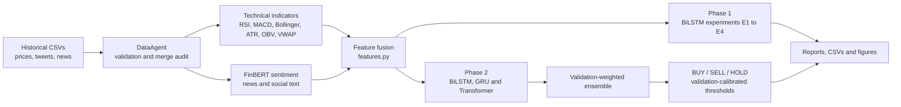
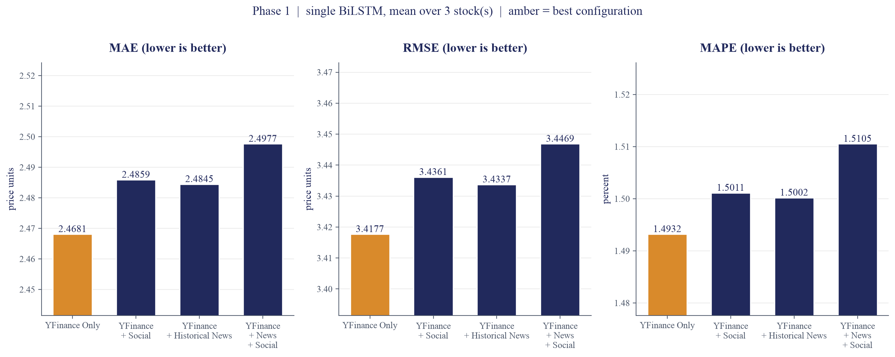
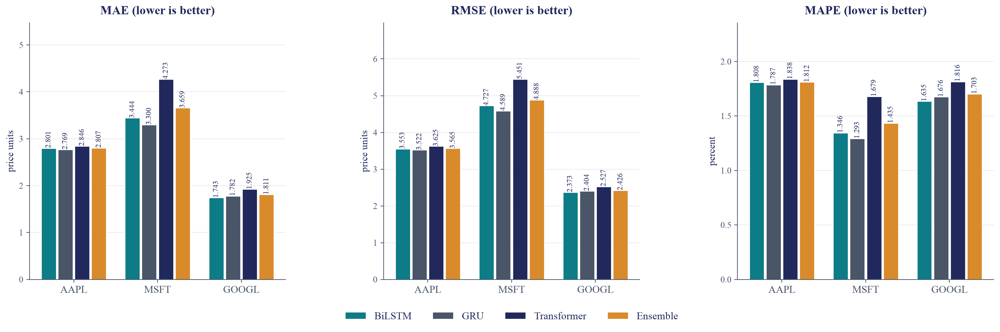
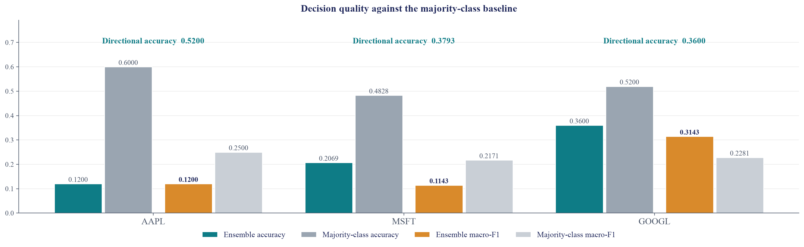
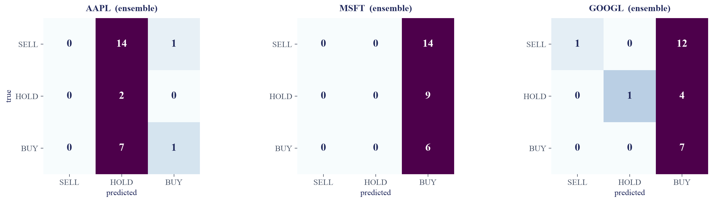

# Multi-Model Agentic AI Framework for Stock Market Prediction Using Hybrid News and Social Media Sentiment Fusion

A chronological study of next-day return prediction for AAPL, MSFT and GOOGL.
Phase 1 compares four BiLSTM feature sets (E1–E4). Phase 2 combines BiLSTM, GRU
and Transformer models into an ensemble with a BUY / SELL / HOLD decision layer.

> **Status:** code consolidated and statically checked (syntax, undefined names).
> Full runs have **not** been executed in this repository yet. Report numbers only
> after you have run the commands below and checked the output files yourself.

## Architecture



## Project structure

| File | Role |
|---|---|
| `main.py` | Entry point. Default runs Phase 1; `PHASE=legacy` runs the five-agent pipeline. |
| `phase1.py` | BiLSTM experiments E1–E4. Also `python phase1.py fetch` / `probe`. |
| `phase2.py` | BiLSTM + GRU + Transformer ensemble, BUY/SELL/HOLD decisions, reports. Run directly. |
| `models.py` | Model definitions and training loops. |
| `features.py` | Feature frame, sequence windows, chronological splits. |
| `evaluation.py` | Regression and classification metrics, walk-forward check, threshold optimisation. |
| `technical_indicators.py` | RSI, MACD, moving averages, Bollinger bands, ATR, OBV, VWAP, Elliott-style features. |
| `data_collection.py` | Loads and validates the offline CSV datasets. |
| `sentiment_analysis.py` | FinBERT sentiment with an on-disk cache. |
| `news_social.py` | NewsAPI and StockTwits collectors (live inference only). |
| `agents.py` | Five-agent pipeline used by the legacy path. |
| `market_regime.py` | Regime features. |
| `utils.py` | Logging, seeds, results folders. |
| `config.py` | Settings. Secrets are read from environment variables only. |
| `visualize.py` | Plot helpers (imported by `main.py`). |
| `result_plots.py` | Writes fig1–fig4 PNGs from the result CSVs. |
| `summary.py` | Prints a one-page summary from the result CSVs. Trains nothing. |
| `build_extended.py` | Builds the 2015–2020 dataset files. |
| `merge_alpaca.py` | Builds `data/historical_news.csv` from the Alpaca news files. |
| `all_data.py` | Converts `data/all-data.csv` (PhraseBank) to `data/labelled_news_eval.csv`. |

## Setup (macOS, zsh, VS Code)

Python 3.11 or 3.12 is recommended. The code has not been tested on a specific
Python version yet; check the version you use with `python3 --version`.

```bash
cd "/path/to/stock-market-prediction-final"
python3 -m venv .venv
source .venv/bin/activate
python -m pip install --upgrade pip
pip install -r requirements.txt
python -c "import torch, pandas, sklearn, transformers; print('torch', torch.__version__, '| MPS', torch.backends.mps.is_available())"
```

Optional, only for the commands noted:
```bash
pip install datasets                       # python phase1.py fetch
pip install playwright && python -m playwright install chromium   # live StockTwits
```

## Data

The CSV files are **not** in this repository. Create `data/` and place:

| File in `data/` | Used by | Notes |
|---|---|---|
| `stock_yfinance_data.csv` | Phase 1, Phase 2 | Required. Date, Open, High, Low, Close, Adj Close, Volume, Stock Name |
| `stock_tweets.csv` | Phase 1, Phase 2 | Required. Date, Tweet, Stock Name, Company Name |
| `historical_news.csv` | Phase 1 (E3, E4) | Required for those experiments. Built by `merge_alpaca.py` |
| `labelled_news_eval.csv` | FinBERT evaluation | Built by `all_data.py` from `all-data.csv` |
| `all-data.csv` | `all_data.py` | Financial PhraseBank. Check its licence before sharing |

The extended 2015–2020 study uses `stock_yfinance_2015_2020.csv`,
`stock_tweets_2015_2020.csv` and `historical_news_2015_2020.csv`, selected with
environment variables (see below).

## Configuration

Copy `.env.example` to `.env` and fill in your own values. **Never commit `.env`.**
`config.py` reads environment variables; it does not load `.env` by itself, so
export the variables in your Terminal before running (for example
`export NEWSAPI_KEY="..."`), or install `python-dotenv` and load the file yourself.

Useful variables:

| Variable | Effect | Default |
|---|---|---|
| `OUTPUT_PATH` | Where results are written | `results/` |
| `HISTORICAL_PRICE_PATH`, `HISTORICAL_TWEETS_PATH`, `HISTORICAL_NEWS_PATH` | Dataset choice | files in `data/` |
| `SIGNAL_BAND` | HOLD band for BUY/SELL/HOLD (sensitivity runs) | `0.005` |
| `HORIZON` | Forecast horizon in trading days | `1` |
| `EXPERIMENT` | Run one Phase 1 experiment | all |

## Running

Run every command from the project folder with the virtual environment active.

```bash
# Phase 1 (E1–E4)
python main.py

# Phase 2 (ensemble and decisions)
python phase2.py

# Summary: reads results_ext/ by default, so for the default results/ run use RESULTS=results
RESULTS=results python summary.py
# Figures: reads config.RESULTS_DIR (results/ by default)
python result_plots.py
```

Extended 2015–2020 study (writes to `results_ext/`):
```bash
export OUTPUT_PATH=results_ext
export HISTORICAL_PRICE_PATH=data/stock_yfinance_2015_2020.csv
export HISTORICAL_TWEETS_PATH=data/stock_tweets_2015_2020.csv
export HISTORICAL_NEWS_PATH=data/historical_news_2015_2020.csv
python main.py
python phase2.py
python summary.py                 # reads results_ext/ by default
python result_plots.py results_ext
```

Sensitivity to the HOLD band (report every band run, not only the best one):
```bash
SIGNAL_BAND=0.010 OUTPUT_PATH=results_b10 python phase2.py
```

## Outputs

Written under `OUTPUT_PATH` (folder names below are as written by the code):

- `phase1/` — per-experiment predictions and metrics, `phase1_report.txt`, `phase1_summary.csv`
- `phase2/` — `model_comparison.csv`, `classification_metrics.csv`, `classifier_metrics.csv`,
  `ensemble_predictions.csv`, `buy_sell_hold.csv`, `confusion_matrix.csv`, `phase2_report.txt`,
  and per-ticker folders with predictions
- `plots/`, `metrics/`, `tables/`, `reports/` — created by `utils.ensure_dirs()`
- `logs/` — one log file per run

## Results

Figures are generated by `result_plots.py` from your own result files. They appear
here only after you have run the code and checked the output.

**Figure 1: Phase 1 ablation (E1 to E4).** Forecasting error by feature set.



**Figure 2: Phase 2 forecasting.** MAE, RMSE and MAPE by model.



**Figure 3: Decision quality.** Accuracy and macro-F1 compared with the majority-class baseline.



**Figure 4: Error structure.** Confusion matrices and feature-group attribution.



Numbers in the tables and text must be copied from `phase1_report.txt` and
`phase2_report.txt`, not typed from memory.

## Limitations

- Next-day direction is difficult. Compare accuracies with the majority-class baseline.
- Sentiment coverage depends on the news and tweet sources, which are uneven across days.
- The StockTwits collector scrapes public pages. Check the site's terms before using it.
- Data files and any API keys are not included.

## Licence

MIT — see [LICENSE](LICENSE). The datasets have their own licences and are not
redistributed here.
